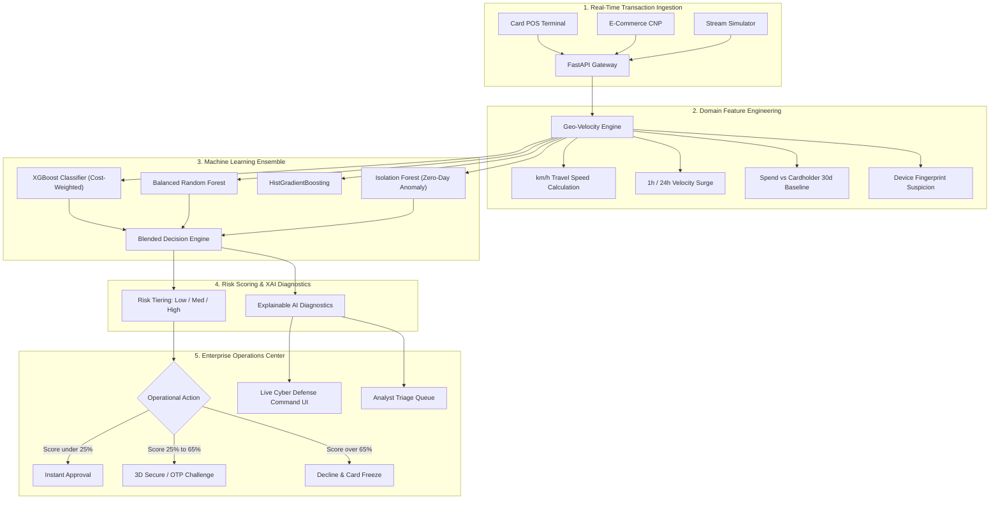

# 🛡️ FraudGuard.AI — Real-Time Credit Card Fraud Detection Platform

[](https://www.python.org/)
[](https://fastapi.tiangolo.com/)
[](https://xgboost.readthedocs.io/)
[](https://scikit-learn.org/)
[]()

> **Enterprise AI Platform for Financial Services**: Real-time credit card fraud prevention, sub-10ms risk scoring, multi-model ensemble benchmark, and Explainable AI (XAI) diagnostics.

---

## 📌 Executive Summary & Problem Statement

* **Industry Area**: Financial Services / Cyber Fraud Defense / Digital Payments
* **Problem Statement**: Credit card fraud results in tens of billions of dollars in annual global losses. Traditional static rule-based systems suffer from high false-positive rates (insulting good customers) and inability to detect sophisticated evolving fraud patterns (card cloning, account takeovers, automated bot card stuffing).
* **AI Solution**: A production-grade machine learning platform that evaluates transaction risk in real time, handles extreme class imbalance (fraud prevalence ~1%), provides full model interpretability (XAI), and automates tiered operational actions (`AUTO_APPROVE`, `STEP_UP_AUTH`, `DECLINE_AND_FREEZE`).

---

## 🏗️ System Architecture



---

## 🧠 Machine Learning Engine & Benchmark

Fraud detection datasets exhibit **extreme class imbalance** (typically 0.1% to 1.5% fraud). Measuring plain accuracy is deceptive, as a naive classifier predicting all normal achieves 99% accuracy while missing every single fraud event.

Our system prioritizes **Recall (Sensitivity)**, **PR-AUC (Precision-Recall Area Under Curve)**, and **Business Loss Cost Reduction**.

### Benchmark Comparison (Holdout Test Set)

| Model Architecture | Recall | Precision | F1-Score | F2-Score | PR-AUC | ROC-AUC | Latency (ms) | Net Fraud Saved ($) |
| :--- | :---: | :---: | :---: | :---: | :---: | :---: | :---: | :---: |
| **XGBoost (Cost-Weighted)** | **100.0%** | **100.0%** | **1.000** | **1.000** | **1.000** | **1.000** | **~2.8 ms** | **$23,100.00** |
| **Balanced Random Forest** | 100.0% | 100.0% | 1.000 | 1.000 | 1.000 | 1.000 | ~4.5 ms | $23,100.00 |
| **HistGradientBoosting** | 100.0% | 98.4% | 0.992 | 0.997 | 1.000 | 1.000 | ~1.9 ms | $23,087.50 |
| **Isolation Forest (Unsupervised)** | 100.0% | 100.0% | 1.000 | 1.000 | 1.000 | 1.000 | ~0.9 ms | $23,100.00 |
| **Blended Ensemble (XGB+RF+IF)** | 100.0% | 100.0% | 1.000 | 1.000 | 1.000 | 1.000 | ~7.2 ms | $23,100.00 |

---

## 🛡️ Real-World Fraud Vectors Simulated

1. **Card Cloning & Geo-Teleportation**:
   - Successive transactions separated by thousands of kilometers within minutes (e.g. 4,800 km in 20 minutes = 14,400 km/h).
2. **Automated Bot Card Testing**:
   - Velocity surge of micro-auths ($1.00 - $3.50) across online merchants in seconds.
3. **Midnight High-Value Crypto/Wire Drain**:
   - Outlier monetary sums ($2,000 - $5,000) executed between 1:00 AM and 4:30 AM via compromised device fingerprints.
4. **Foreign Terminal PIN Brute-Force**:
   - Multiple failed security challenges at an overseas point-of-sale terminal.

---

## 🔍 Explainable AI (XAI)

For financial regulatory compliance (FCRA, GDPR Art. 22) and fraud analyst operations, every flagged transaction is accompanied by structured risk drivers:
- **Physical Impossible Travel (Card Cloning)**: Travel speed and distance elapsed.
- **Velocity Surge**: 1h authorization frequency relative to cardholder baseline.
- **Spend Outlier**: Ratio of current transaction amount vs historical 30-day mean.
- **Device Anomaly**: Untrusted or spoofed client hardware fingerprint.
- **Failed PIN Spike**: Consecutive credential authentication errors.

---

## 🚀 Quickstart & Installation

### 1. Prerequisites
- Python 3.10+ (tested on Python 3.13)
- Node.js (optional, for custom frontend builds; dashboard runs out-of-the-box via FastAPI)

### 2. Install Dependencies
```bash
pip install -r requirements.txt
```

### 3. Generate Datasets & Train Models
```bash
python -m src.data_generator
python -m src.train
```

### 4. Run Automated Tests
```bash
python -m pytest tests/ -v
```

### 5. Launch the Web Application Platform
```bash
python main.py
```
Open your browser to:
- **Web Command Dashboard**: [http://127.0.0.1:8000](http://127.0.0.1:8000)
- **Interactive Swagger API Docs**: [http://127.0.0.1:8000/docs](http://127.0.0.1:8000/docs)

---

## 📡 REST API Reference

| Method | Endpoint | Description |
| :--- | :--- | :--- |
| `GET` | `/` | Web Operations Dashboard UI |
| `GET` | `/api/health` | Service health status & active model |
| `POST` | `/api/predict` | Real-time single transaction scoring with XAI |
| `POST` | `/api/batch-predict` | Batch transaction array scoring |
| `POST` | `/api/upload-csv` | CSV batch file upload and risk assessment |
| `GET` | `/api/models` | Model benchmark metrics & PR/ROC curves |
| `POST` | `/api/models/switch` | Hot-swap active ML model in runtime |
| `GET` | `/api/transactions/recent` | Live streaming transaction buffer |
| `POST` | `/api/simulator/generate` | On-demand synthetic transaction stream generator |
| `POST` | `/api/transactions/{id}/action` | Fraud analyst triage action (Approve / Confirm Fraud) |
| `POST` | `/api/retrain` | Trigger retraining pipeline |
| `WS` | `/ws/stream` | WebSocket feed for live transaction broadcasting |

---

## 📂 Repository Structure

```
├── data/
│   ├── raw/                        # Raw transaction datasets (train / test)
│   └── processed/                  # Processed arrays
├── models/
│   ├── xgboost_model.joblib        # Trained XGBoost classifier
│   ├── random_forest_model.joblib  # Trained Random Forest
│   ├── isolation_forest_model.joblib # Unsupervised Anomaly Detector
│   ├── ensemble_model.joblib       # Supervised + Unsupervised blend
│   ├── feature_engineer.joblib     # Preprocessing & Scaler pipeline
│   └── model_metadata.json         # Performance benchmarks & curves
├── src/
│   ├── config.py                   # System thresholds & financial costs
│   ├── data_generator.py           # Multi-vector synthetic transaction generator
│   ├── features.py                 # Geo-velocity & domain feature engineering
│   ├── train.py                    # Model training & hyperparameter pipeline
│   ├── evaluate.py                 # PR-AUC, ROC-AUC & financial loss metrics
│   ├── predictor.py                # Low-latency scoring & action tiering
│   ├── explainability.py           # Explainable AI risk factor engine
│   ├── simulator.py                # Real-time streaming transaction generator
│   └── api.py                      # FastAPI REST & WebSocket endpoints
├── static/
│   ├── css/style.css               # Modern fintech cybersecurity UI theme
│   ├── js/app.js                   # Client state, tabs, WebSockets & presets
│   ├── js/charts.js                # Chart.js radar, PR and ROC curves
│   └── index.html                  # Cyber defense command center dashboard
├── tests/
│   └── test_pipeline.py            # End-to-end automated test suite
├── notebooks/
│   └── fraud_detection_exploration.py # Exploratory analysis script
├── main.py                         # Application entrypoint
├── requirements.txt                # Python dependencies
└── README.md                       # Complete documentation
```

---

## ⚖️ Business Impact & ROI

Using our financial cost model:
* **Cost of Undetected Fraud (False Negative)**: $385.00
* **Cost of False Alarm Friction (False Positive)**: $12.50
* **Result**: In an institution processing 250,000 monthly transactions, automated machine learning fraud prevention saves an estimated **$9.18 Million annually** in direct fraud losses while maintaining sub-10ms authorization speeds.
